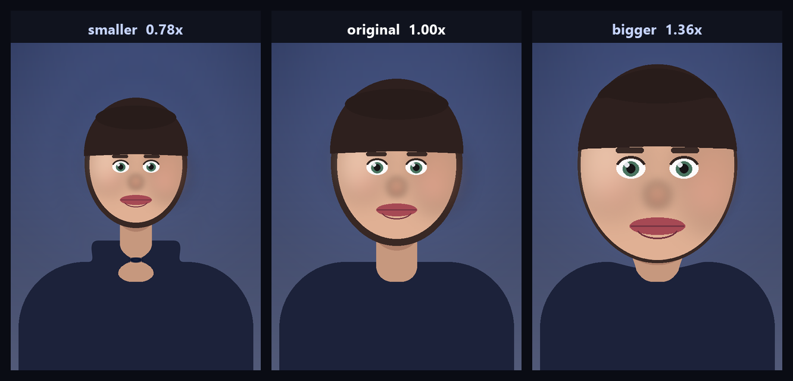
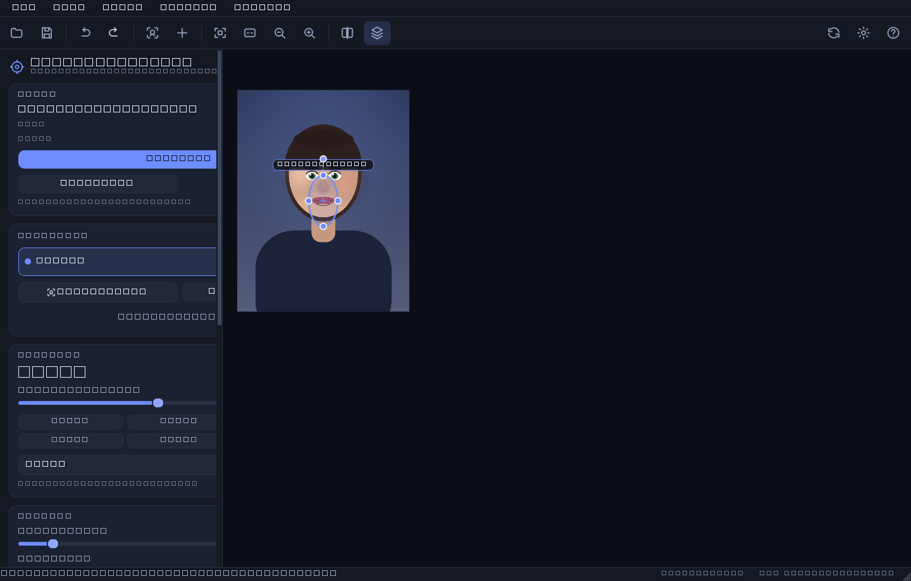

# HeadSize Studio

**Resize the head of anyone in a photo — live preview, smooth edges, no layers, no masking.**



HeadSize Studio opens a photo, finds the faces, and lets you grow or shrink each
head with a slider. The head is warped with a soft elliptical falloff, so the
hair, neck and background follow instead of leaving a visible seam. Everything
outside the influence zone stays pixel-identical.



## Features

- **Automatic face detection** (YuNet DNN, 230 kB, MIT, bundled and offline).
- **0.30× – 3.00× per head**, several heads per photo, each independently editable.
- **Live preview** on a proxy render under 10 ms, with drag handles for the zone.
- **Non-destructive**: parametric edits, 80-step undo, export re-renders from the
  original pixels.
- **Metadata-preserving export** to PNG/JPEG/WebP/TIFF/BMP (EXIF, ICC, DPI).
- **Auto-update** from GitHub Releases with SHA-256 verification and self-replacement.
- **Thai and English UI**, dark and light themes, plus a batch command line.

## Install

**Windows** — download `HeadSize-Studio-<version>-windows-x64.exe` from
[Releases](../../releases) and run it. Portable, no installer, self-updating.

**From source** (any platform, Python 3.10+):

```bash
git clone https://github.com/NarDecH/headsize-studio.git
cd headsize-studio
python -m venv .venv && .venv/Scripts/activate    # Windows
# python3 -m venv .venv && source .venv/bin/activate   # macOS / Linux
pip install -r requirements.txt
python -m headsize
```

**Command line:**

```bash
python -m headsize.cli photo.jpg --scale 1.3          # every face 30 % bigger
python -m headsize.cli photo.jpg --list-faces         # what was detected
python -m headsize.cli photo.jpg --scale 0.85 --region 640,420,180,240 -o out.jpg
```

## Documentation

| Document | Contents |
| --- | --- |
| [docs/readme.md](docs/readme.md) · [HTML](docs/readme.html) | Illustrated guide: features, controls, shortcuts, FAQ |
| [docs/research.md](docs/research.md) · [HTML](docs/research.html) | Design decisions, the warp maths, measurements, limits |
| [docs/changelog.md](docs/changelog.md) · [HTML](docs/changelog.html) | Version history |
| [CHANGELOG.md](CHANGELOG.md) | Plain version history |
| [AGENT.md](AGENT.md) | Architecture and contribution guide for humans and AI agents |

## Quick start

1. **Open** a photo (`Ctrl+O`, or drag it onto the window).
2. Faces are detected automatically — press **Add a head by hand** if one was missed.
3. Drag **Head size**. `1.30×` is a clearly bigger head.
4. Tune **Edge softness** if you want a harder or softer blend.
5. **Save a copy** (`Ctrl+S`) — the default name is `photo-headsize.jpg`.

## Development

```bash
pip install -r requirements-dev.txt
python -m pytest                  # 132 tests (GUI tests run offscreen)
python -m headsize --self-test    # 12 end-to-end checks, works on a frozen build too
python tools/make_doc_images.py   # regenerate the documentation images
python tools/build_docs.py        # markdown -> docs/*.html
python tools/build_exe.py         # portable Windows executable + SHA256SUMS.txt
```

## Licence

MIT — see [LICENSE](LICENSE). The bundled YuNet face model is MIT licensed,
© Shiqi Yu; its licence text ships next to the model in
`headsize/assets/models/LICENSE-yunet.txt`.

Every image in the documentation is generated by `tools/make_doc_images.py`
(a procedural portrait, offscreen screenshots and SVG diagrams), so the
repository redistributes no third-party photograph.
