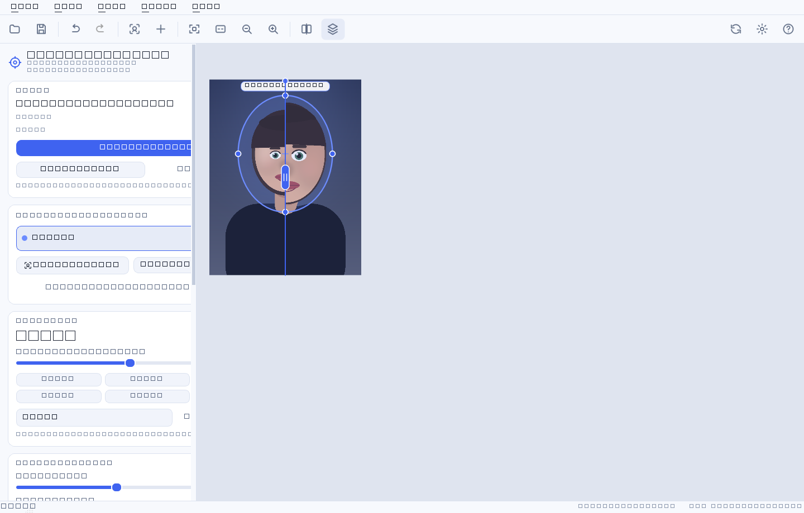
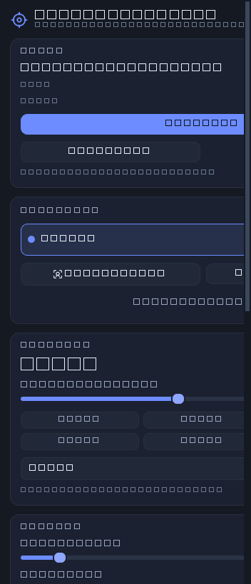
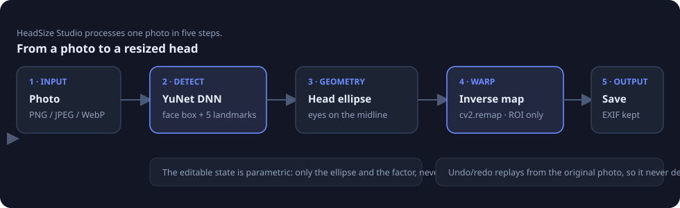
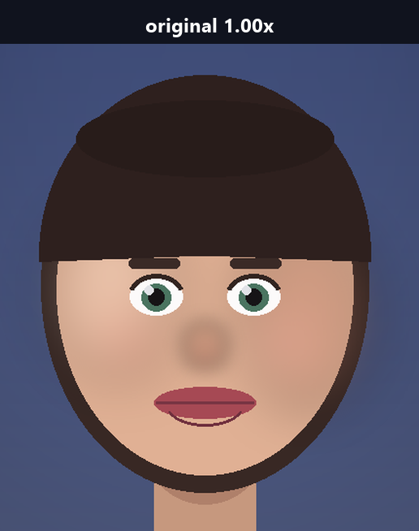
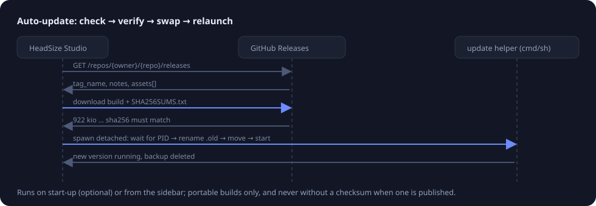

# HeadSize Studio

**Resize the head of anyone in a photo — with a live preview, no layers, no manual selection.**


*One click on **Detect faces**, one slider. Left: 0.78×, middle: original, right: 1.36×.*

---

## Why it exists

Making a head bigger is the oldest joke in photo editing, and it is surprisingly
annoying to do well: you lasso the head, scale it, and the neck, hair and
background give you away with a hard seam. HeadSize Studio does the boring part
for you.

- **Opens a photo, finds the faces.** The YuNet neural detector locates each
  face and its five landmarks in about 16 ms.
- **Grows or shrinks the head smoothly.** A soft elliptical warp, so the hair,
  the neck and the background follow instead of getting cut off.
- **Live preview at full speed.** Sliders and drag handles update the picture
  while you drag, always from the untouched original.
- **Multiple faces, individually controlled.** Every head gets its own zone,
  size, tilt and visibility switch.
- **Saves what you see.** PNG, JPEG, WebP, TIFF or BMP with EXIF, ICC profile
  and DPI preserved.
- **Updates itself.** A portable build checks GitHub Releases, verifies the
  checksum, swaps itself and restarts.
- **Thai and English UI**, dark and light themes.

## Screenshots


*The zone around the head is visible while you edit: drag the middle to move it,
the four dots to resize it, the top dot to tilt it. Everything outside stays
pixel-identical.*



*Split view: the original on the left, the result on the right, with a draggable
divider. **Detect faces** also fills the head list on the left.*

## Install

### Windows — portable build (no installer)

1. Download `HeadSize-Studio-<version>-windows-x64.exe` from
   [Releases](../../releases).
2. Run it. Nothing is installed, nothing is written outside your user folder.
3. The app checks for newer versions on start-up and can update itself in place.

### From source (Windows, macOS, Linux)

```bash
git clone https://github.com/NarDecH/headsize-studio.git
cd headsize-studio
python -m venv .venv
# Windows:  .venv\Scripts\activate      macOS/Linux:  source .venv/bin/activate
pip install -r requirements.txt
python -m headsize            # the GUI
```

Requirements: Python 3.10+ and the packages in
[requirements.txt](../requirements.txt) (`numpy`, `opencv-python-headless`,
`PyQt6`, `Pillow`). The face model ships with the repository, so detection works
offline out of the box.

### Command line (batch it)

```bash
python -m headsize.cli photo.jpg --scale 1.3                 # every face +30 %
python -m headsize.cli photo.jpg --list-faces                # what did it find?
python -m headsize.cli photo.jpg --scale 0.85 \
    --region 640,420,180,240 -o small.jpg                    # by hand, no detection
```

## Quick start

1. **Open a photo** — the button in the sidebar, `Ctrl+O`, or drag the file onto
   the window.
2. The app finds the faces automatically. If it found nothing, press
   **Add a head by hand** and drag the zone over the head.
3. Drag the **Head size** slider. `1.00×` is the original size; `1.30×` is a
   clearly bigger head; `1.75×` is a meme.
4. Fine-tune with the zone sliders — **edge softness** is the one that matters
   most (see below).
5. Press **Save a copy** (`Ctrl+S`). The suggestion is
   `photo-headsize.jpg` so the original is never overwritten by accident.

## The controls

| Control | What it does | Default |
| --- | --- | --- |
| **Head size** | Scale of the head inside the zone. 0.30×–3.00× | 1.00× |
| **Edge softness** (feather) | How much of the zone is used to blend the scale back to 1.0. Small = the whole head scales rigidly and the rim is tighter; large = softer, but the head grows less than the number says. | 22 % |
| **Zone width / height** | Size of the elliptical influence zone. Bigger zone = more room to grow before the rim stops it. | from the face box |
| **Zone tilt** | Rotation of the zone, for tilted heads. Also dragged with the top handle. | from the eyes |
| **Render quality** | Resampling filter: fast (bilinear), balanced, high (bicubic). Fast is for dragging sliders on huge photos. | High |
| **Compare** | Result, Original, or Split with a draggable divider (`C` cycles). | Result |
| **Show the influence zone** | The dashed ellipse overlay (`H`). | On |
| **Keep EXIF / ICC / DPI** | Metadata is copied into the saved file. | On |
| **Channel** | Stable or Beta release channel for updates. | Stable |



*Every control lives in one column. The head list shows each detected head with
its own size, visibility switch and delete button.*

## Keyboard shortcuts

| Keys | Action | Keys | Action |
| --- | --- | --- | --- |
| `Ctrl+O` | Open | `Ctrl+Z` / `Ctrl+Y` | Undo / redo |
| `Ctrl+S` | Save a copy | `Ctrl+R` | Reset all edits |
| `Ctrl+Shift+S` | Save as… | `Ctrl+D` | Detect faces |
| `Ctrl+N` | Add a head | `Del` | Delete the selected head |
| `Ctrl+0` | Fit to window | `Ctrl+1` | 100 % |
| `Ctrl+=` / `Ctrl+-` | Zoom | `C` | Cycle compare modes |
| `H` | Show/hide the zone | `Ctrl+U` | Check for updates |
| `F1` | Shortcuts | `Ctrl+Q` | Quit |

In the canvas: **wheel** zooms under the cursor, **drag** moves the selected
head, **middle-drag** or **space-drag** pans, **double-click** on empty space
adds a head, **right-click** opens the zone menu, **Shift** while resizing keeps
the zone's aspect ratio.

## How it works



1. The photo is decoded once and kept in memory. Nothing is ever modified in
   place — the edit is just a list of ellipses with scale factors.
2. YuNet returns a face box plus the two eyes, the nose and the mouth corners.
3. From those proportions a head ellipse is estimated (hair included), centred
   on the eye line and tilted with it.
4. The engine builds an inverse coordinate map per zone and hands it to
   `cv2.remap`; only the pixels inside the zone are touched.
5. Saving renders at full resolution from the original pixels, so the tenth
   preview you looked at is exactly what you get.

Here is the warp at 1:1 on the face, before and after a 1.36× enlargement — hair
and skin scale together, the eyes and mouth move outward with the skull, and the
background only compresses gently around the rim:




The interesting part — the maths, the measured behaviour and the alternatives
that were rejected — is in **[research.md](research.md)**.

## Auto-update



At start-up (and from the sidebar) the app asks GitHub for the newest release of
its own repository. When a newer version exists it shows the release notes and,
on request:

1. downloads the build for your platform,
2. verifies it against the `SHA256SUMS.txt` published with the release,
3. writes a small helper script that waits for the app to exit, renames the old
   build to `*.old`, moves the new one in, and restarts it.

If anything fails — no network, checksum mismatch, read-only folder — nothing is
replaced and the reason is shown in the sidebar. Updates apply to the portable
build; running from source, the button opens the release page instead.

Point the app at your own fork with **Tools → Settings** or the environment
variables `HEADSIZE_UPDATE_OWNER` and `HEADSIZE_UPDATE_REPO`.

## FAQ

**Does it work on a photo where the face is turned sideways?**
Frontal and slightly turned faces work well; a hard profile may not be detected.
Place a zone by hand in that case, or use `--region` on the command line.

**Why does the head stop growing past about 1.5×?**
The zone has a fixed rim and nothing outside it moves, so the head can only grow
until its outline reaches the rim. Enlarge the zone (drag the side handles) and
you get more room. The maths is in [research.md](research.md).

**Is the original file modified?**
No. Saving defaults to `name-headsize.ext`, and `Ctrl+S` only overwrites the file
you opened if you choose it in the dialog.

**Is my photo uploaded anywhere?**
No. Detection runs locally from the bundled model. The only network traffic is
the update check, which sends nothing about your images.

**Where are the settings stored?**
`%APPDATA%\HeadSizeStudio\config.json` on Windows,
`~/Library/Application Support/HeadSizeStudio/` on macOS,
`~/.config/HeadSizeStudio/` on Linux.

## Development

```bash
pip install -r requirements-dev.txt
python -m pytest                     # 132 tests, GUI tests run offscreen
python -m pytest -m integration      # needs HEADSIZE_TEST_IMAGE=/path/to/photo.jpg
python tools/make_doc_images.py      # regenerate docs/assets
python tools/build_docs.py           # markdown -> docs/*.html
python tools/build_exe.py            # PyInstaller portable build
```

The repository layout and the invariants an agent must preserve are documented in
[AGENT.md](../AGENT.md).

## Credits and licence

- **HeadSize Studio** — MIT ([LICENSE](../LICENSE)).
- **YuNet** face detection model, © Shiqi Yu, MIT licence — bundled in
  `headsize/assets/models` with its licence text.
- Built with [PyQt6](https://www.riverbankcomputing.com/software/pyqt/),
  [OpenCV](https://opencv.org/), [NumPy](https://numpy.org/) and
  [Pillow](https://python-pillow.org/).
- Every screenshot and illustration in this documentation is generated by
  `tools/make_doc_images.py`, so no third-party photograph is redistributed.
