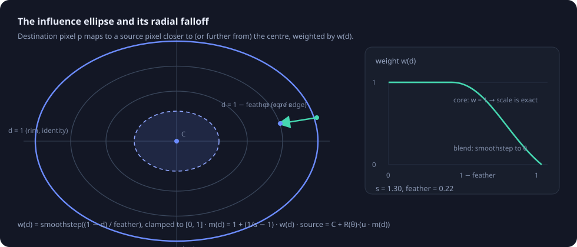
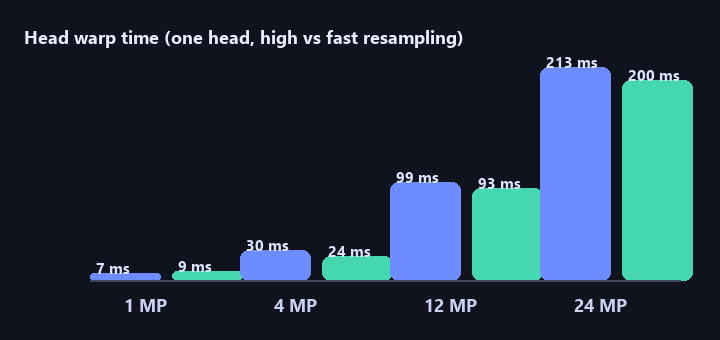
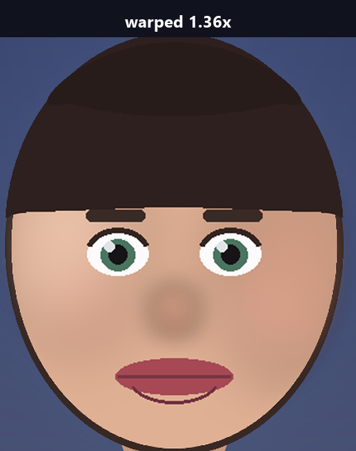

# HeadSize Studio — design and measurements

*Everything in this document was measured on the machine and versions listed at
the bottom, with the code in this repository. Reproduce any number with the
commands in [Reproducing the measurements](#reproducing-the-measurements).*

## 1. The problem

"Make my head bigger" is a liquid-resize problem, not a resize problem. Scaling a
rectangular selection produces a visible seam because the pixels around the
selection have to go somewhere. Three families of solutions exist:

| Approach | Result |
| --- | --- |
| Cut, scale, blend | Fast, but hair and background never line up; a seam remains unless you mask by hand. |
| Mesh / spline warp (dlib landmarks + Delaunay + Thin-Plate-Spline) | Very controllable, but needs a dense landmark model, a triangulation, and per-photo interaction. |
| **Local radial warp around a known centre** (chosen) | One formula, no segmentation, no seams, and it degrades gracefully: only the pixels inside the influence zone change. |

HeadSize Studio implements the third, with the influence zone derived from a face
detector and always adjustable by hand.

## 2. Face detection: what is actually available

The first decision was the detector. It had to be small, permissively licensed,
accurate enough to *place* an ellipse (not to identify anyone), fast on a CPU,
and easy to bundle into a PyInstaller executable.

| Option | Distribution size | Runtime dependencies | Licence | Landmarks | Verdict |
| --- | --- | --- | --- | --- | --- |
| **YuNet (`cv2.FaceDetectorYN`)** | **0.22 MiB ONNX, shipped in-repo** | none beyond OpenCV | MIT (model), Apache-2.0 (opencv_zoo) | 5 | **chosen** |
| OpenCV Haar cascades | n/a | n/a | — | none | **removed in OpenCV 5.0**: `cv2.CascadeClassifier` no longer exists (verified: `hasattr(cv2, "CascadeClassifier") is False`) |
| MediaPipe (BlazeFace / FaceMesh) | 21.4 MiB wheel | `absl-py`, `flatbuffers`, `sounddevice`, `opencv-contrib-python` | Apache-2.0 | 6 / 468 | accurate, but 100× the payload and a second OpenCV build |
| dlib (HOG or CNN) | 3.2 MiB **source** tarball | C++ toolchain (no Windows wheel) | Boost | 68 with a second model | build step on every platform |
| InsightFace (SCRFD / RetinaFace) | 1.1 MiB wheel + `onnxruntime` | `onnx`, `onnxruntime`, `opencv-python`, `tqdm` | weights are **non-commercial research only** | 5 / 68 | licence and weight rule it out for a redistributable app |

YuNet wins because the model is 230 kB, it is part of OpenCV itself (no extra
runtime), it is MIT licensed, and it returns exactly what the geometry step needs:
a box plus five landmarks.

Measured detection latency (CPU, warm, same photo):

| Input | Time |
| --- | --- |
| 512 × 512 photo | 16.0 ms |
| 1600 × 1600 (no downscale) | 146.5 ms |
| 4000 × 3000 photo (downscaled to a 1600 px proxy) | 119.2 ms |

Detection is therefore capped to 1600 px on the long side (`DETECT_MAX_SIDE`):
on a 24 MP photo that is 5× less work than running the model on the full frame
and costs nothing in accuracy, because YuNet detects faces of roughly 10–300 px.

> **Note.** The bundled model is `face_detection_yunet_2026may.onnx`, the
> dynamic-input variant required by OpenCV 5's ONNX Runtime engine. The
> fixed-shape `2023mar` model ships as a fallback for OpenCV 4.x builds.
> Both are SHA-256 pinned in `headsize/core/detector.py`; the same digests are
> used to verify a first-run download when the assets are missing.

## 3. From a face box to a head

A detector box covers the face — roughly from the eyebrows to the chin — not the
head. Classic proportions give the conversion, and they are stable across people:

| Landmark | Fraction of total head height |
| --- | --- |
| vertex (top of skull) | 0.00 |
| face box top | 0.30 |
| **eye line** | **0.50** |
| face box bottom (chin) | 1.00 |

So `head_height = box_height / 0.70`, the head centre sits *on the eye line*, and
the head width is about 1.30 × the box width (cheeks are narrower than the skull
plus hair). Because the eye line is the centre, the head is automatically
placed correctly even when the box is loose.



Finally the ellipse is padded (`PAD_X = 1.25`, `PAD_Y = 1.22`) so that hair and a
margin of background are inside it. That padding is not cosmetic — see
[§5](#5-the-rim-is-a-fixed-point) — it decides how far a head can grow.

The zone's tilt comes from the angle of the two eye landmarks, so a tilted head
gets a tilted ellipse.

## 4. The warp

### 4.1 Inverse mapping

Forward mapping (push every source pixel to its new position) leaves holes when
magnifying and needs splatting. Instead the engine computes, for every
*destination* pixel `p`, where to read from:

```
u  = R(−θ) · (p − C)                       # into the ellipse frame
d  = ‖(u.x / rx, u.y / ry)‖                # normalised elliptical radius, 1 = rim
w  = smoothstep(clamp((1 − d) / feather))  # 1 in the core, 0 at the rim
m  = 1 + (1/s − 1) · w                     # radial sampling factor
src = C + R(θ) · (u · m)                   # where to read this pixel from
```

`cv2.remap` then does one resampling pass with a cubic or bilinear kernel. Because
`w` reaches exactly 1 in the core and exactly 0 at the rim, two properties fall
out and are asserted by the test-suite:

- **`s = 1` is the identity**, bit for bit (`test_scale_one_is_identity`).
- **Pixels with `d ≥ 1` are never written** — the changed-pixel bounding box is
  exactly the ellipse box (`test_outside_ellipse_is_untouched`).

`smoothstep` is used rather than a linear ramp because its derivative is zero at
both ends: the mapping is C¹ at `d = 1`, so no visible ring or seam can appear at
the rim (`test_falloff_is_c1_at_the_rim`).

### 4.2 Only the zone is processed

For `s > 1` every destination pixel inside the zone reads from *inside* the zone,
so the work is limited to the ellipse's bounding box:

- the destination ROI is the clipped ellipse bounding box,
- the source slice is that ROI **plus** `ceil(|1/s − 1| · r_max) + 2` pixels, so a
  shrink can read genuine neighbours instead of a replicated border,
- the coordinate map is generated in row bands, which keeps peak memory flat on
  large photos.

Measured end-to-end warp time for one head (single-threaded, includes map
construction, ROI slicing and the remap):

| Photo | Fast (bilinear) | High (bicubic) |
| --- | --- | --- |
| 1 MP (1200 × 830) | 7.3 ms | 9.3 ms |
| 4 MP (2000 × 1500) | 30.1 ms | 24.5 ms |
| 12 MP (4000 × 3000) | 98.9 ms | 92.8 ms |
| 24 MP (6000 × 4000) | 213.4 ms | 200.1 ms |



Interactive previews use a ≤ 1400 px proxy, which is roughly a 1 MP warp — under
10 ms, comfortably inside a 60 Hz frame, which is why the sliders feel instant and
why no background thread is needed for preview rendering.

The result at 1:1, with the same zone geometry as the app derives automatically:



### 4.3 Minification is pre-blurred

When shrinking, each destination pixel covers more than one source pixel, and
point-sampling it would alias. The source ROI is therefore blurred with
`σ = 0.6 · (1/s − 1)` before the remap — cheap, and it removes the shimmer on
hair and fabric edges (`_apply_single_inplace` in `headsize/core/warp.py`).

## 5. The rim is a fixed point

This is the one behaviour worth understanding before using the app:

> Because nothing outside the influence zone moves, the head can only grow until
> its outline reaches the rim. **Maximum head growth ≈ 1 / (head radius ÷ zone
> radius).**

Measured on the bundled illustration (head half-width 152 px) as the function of
the zone size and the requested factor:

| Zone radius | Head / zone | Feather | Requested 1.36× |
| --- | --- | --- | --- |
| 152 px (zone == head) | 1.00 | 0.25 | **1.00×** — the silhouette cannot move at all |
| 200 px | 0.76 | 0.35 | 1.118× |
| 200 px | 0.76 | 0.25 | 1.151× |
| 200 px | 0.76 | 0.20 | 1.171× |
| 200 px | 0.76 | 0.15 | 1.197× |
| 236 px | 0.64 | 0.22 | 1.289× |

And on a real photograph (detector box measured before and after the warp), with
the default automatic zone and `feather = 0.22`:

| Requested | Measured face box growth |
| --- | --- |
| 0.80× | 0.78× |
| 1.30× | **1.34×** |
| 1.60× | 1.47× (approaching the rim) |
| 2.00× | 1.56× / 1.83× (capped) |

Two consequences shaped the defaults:

1. **The zone must be bigger than the head.** The earliest build used
   `PAD_X = 1.12`, which put the head outline at ~0.85 of the zone radius and
   capped growth at ~1.2× — the slider said 1.4× and the head barely changed.
   Raising the padding to `1.25 / 1.22` moved the outline to ~0.7 of the radius,
   which is why 1.30× now measures 1.34×.
2. **Feather trades accuracy for smoothness.** A smaller feather keeps more of
   the head inside the rigid core (so the number on the slider is what you see)
   at the cost of a narrower transition band around the hair. `0.22` was chosen
   as the best compromise; the slider exposes 0–90 % for anyone who disagrees.

Predictably, shrinking is not affected by this limit — measured 0.78× for a
requested 0.80× at every feather value — because the source samples are simply
pulled in from outside.

## 6. Parametric state, not pixels

The document stores the original image plus a list of zones:

```python
HeadRegion(cx, cy, rx, ry, angle, scale, feather, enabled)
```

Everything else follows:

- **Undo/redo is free and lossless.** A snapshot is nine floats per zone, and
  replaying it re-renders from the original pixels, so the fiftieth undo is as
  sharp as the first.
- **What you see is what you save.** Saving re-renders at full resolution with
  the chosen kernel, so a proxy preview never ends up in the file.
- **Overlapping zones resample once each.** Zones are applied in order, one
  `remap` per zone. Non-overlapping zones are exact; two overlapping heads in the
  overlap band are resampled twice, which is the documented trade-off for not
  building a composite coordinate map per connected component.

## 7. Known limits and failure modes

| Situation | Behaviour | Workaround |
| --- | --- | --- |
| Hard profile face | YuNet may find nothing | place a zone by hand, or `--region` on the CLI |
| Head partly off-frame | the zone is clipped, the warp is still correct | none needed (border replicated) |
| Zone larger than the photo | clipped to the image, handles still work | — |
| Hair against a busy background | the background compresses inside the blend band; at extreme scales it looks stretched | enlarge the zone, or lower the feather |
| Very small scale (< 0.6×) | background bleeds into the head, because the warp pulls surrounding pixels in | crop or mask first; the effect is honest about what it does |
| Two heads touching | both zones warp, the overlap is warped twice | acceptable in practice; per-zone `enabled` toggles let you check |
| 16-bit / CMYK / palette images | converted to 8-bit RGB on load | export as PNG |

## 8. Alternatives that were considered and rejected

- **Delaunay + Thin-Plate-Spline mesh warp** (the "face retargeting" literature):
  smoother deformation fields for a whole face *expression*, but it needs 68
  landmarks and a triangulation, and it deforms the face rather than resizing the
  head. A radial scale keeps the face itself intact.
- **Seam carving / content-aware scaling**: changes the whole photo's geometry,
  not one object.
- **Generative inpainting (diffusion)**: would guess the shoulders behind a
  bigger head, but requires a large model download, changes identity, and is not
  reproducible offline.
- **Forward mapping + splatting**: simpler to read, worse to look at; holes and
  intensity artefacts.
- **Per-pixel optical flow between two renders**: no benefit for a purely
  geometric edit.

A future direction worth exploring is an *incompressible* warp: instead of
decaying to identity at a fixed rim, conserve area so the background around the
head is pushed outwards rather than compressed, which would allow arbitrary
growth factors with no rim cap.

## 9. Quality assurance

- **132 automated tests** (`python -m pytest`), covering the map maths, the
  identity and untouched-pixel guarantees, the geometry model, the document
  history, image IO, the update flow (including a real Windows file swap) and the
  GUI offscreen (layout, drag, save, theme/language switches, screenshot
  richness).
- The core promise — *scaling by s scales the core by exactly s* — is measured
  from pixels rather than asserted on internals: a disk of a known radius is
  warped and its radius re-measured from its area (`test_core_scales_exactly`).
- Real-photo verification re-runs the detector on the warped output and compares
  the face box (`tests/test_detector.py`, `-m integration`).
- The release workflow re-runs the suite on Windows/Linux/macOS for Python 3.10
  to 3.14 before building anything.

## 10. Reproducing the measurements

```bash
# timings (writes docs/assets/benchmark.json and benchmark.png)
python tools/make_doc_images.py

# detector comparison, latency, effective scale on a real photo
HEADSIZE_TEST_IMAGE=/path/to/portrait.jpg python -m pytest -m integration -v

# the guarantee tests
python -m pytest tests/test_warp.py tests/test_geometry.py -v

# end-to-end on a photo from the command line
python -m headsize.cli portrait.jpg --list-faces
python -m headsize.cli portrait.jpg --scale 1.3 -o big.png
```

**Measurement environment.** Windows 11 (10.0.26200), Intel Core i5-class
(Skylake, 8 logical cores), Python 3.14.7, OpenCV 5.0.0, NumPy 2.5.4,
PyQt6 6.11.0, Pillow 12.3.0. Timings are single-run wall clock from Python;
absolute numbers will differ on other hardware, the ratios will not.

## 11. References

1. Wei, H., Yang, S., Yu, S. *YuNet: A Tiny Millisecond-level Face Detector.*
   Machine Intelligence Research, 2023. <https://doi.org/10.1007/s11633-023-1423-y>
2. OpenCV Zoo — `face_detection_yunet` model card and licences.
   <https://github.com/opencv/opencv_zoo/tree/main/models/face_detection_yunet>
3. OpenCV documentation — `cv2.remap`, `cv2.warpAffine`, border extrapolation.
   <https://docs.opencv.org/5.0/d1/da0/tutorial_py_table_of_contents_imgproc.html>
4. Perlin, K. *Improving the smoothstep function* (the C¹ argument for smoothstep
   over a linear ramp).
5. Forsyth, D., Ponce, J. *Computer Vision: A Modern Approach* — inverse vs
   forward warping, splatting artefacts.
6. Adobe Photoshop *Liquify → Bloat*: the same radial formulation, applied by
   hand rather than from face geometry.
7. Face proportions: the classical "eyes on the vertical midline of the head"
   rule (Leonardo's *Vitruvian* canon, still the standard in figure drawing and
   in face-alignment literature).
